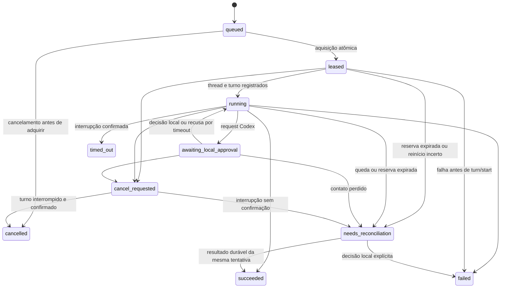

# Estados e política de recuperação



Estados terminais: succeeded, failed, cancelled, timed_out. Não podem ser sobrescritos.
O histórico de mudanças fica em tabela própria e é retornado por get_task. A API
progress aceita running/awaiting_local_approval; preserva cancel_requested e
needs_reconciliation. Continuação exige tarefa terminal, thread persistida e ausência
de outra continuação ativa/queued na mesma thread. O workspace não muda.

## Falhas

- Queda de rede: Codex continua até o timeout; eventos/resultados ficam no journal
  local. O servidor pode marcar reconciliação, mas aceita o resultado da mesma tentativa.
- Reinício do servidor: SQLite e volume conservam as reservas e os resultados.
- Reinício do worker: primeiro reenviar o outbox. Se há final durável, publicar sem
  inferir outra vez. Se não há final, declarar incerteza e bloquear novas aquisições.
- Queda do App Server após intenção de turn/start: reconciliação, nunca replay.
- Timeout/cancelamento: turn/interrupt, aguardando turn/completed. Se não há confirmação
  em 15 segundos, fechar o processo e marcar reconciliação. RPC/startup pode acrescentar
  até 30 segundos de tolerância ao deadline; não é um deadline rígido em tempo real.
- Cancelamento não faz rollback dos arquivos e não comprova reversão de efeitos externos.

Uma tarefa incerta impede novas tarefas no worker até inspeção. Depois de verificar
processos, thread e arquivos, usando configuração local do worker:

```bash
.venv/bin/codex-bridge reconcile TASK_ID ATTEMPT_ID failed --confirm-no-active-turn
```

A identidade de tentativa está no journal local e no endpoint worker autenticado. Não
adicione a mesma tarefa à fila com uma nova chave apenas para "tentar de novo" sem
avaliar efeitos parciais. Reconciliação não reexecuta a instrução.

O banco local de threads do Codex não é manipulado pela ponte. Não há exactly-once;
idempotência protege submissão/reenvio, mas não transforma efeitos locais em transações.
