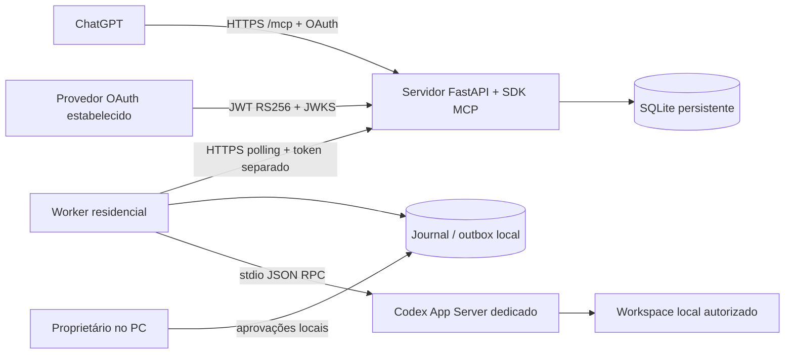

# codex-chatgpt-mcp-proxy

Ponte pessoal entre um cliente MCP (incluindo ChatGPT) e o Codex CLI em um computador
residencial. O computador só inicia conexões HTTPS de saída. As tarefas retornam um ID;
status e resultados são consultados depois, sem prometer notificações espontâneas.



## Início rápido local

Requer Python 3.12 e Codex CLI autenticado. Protocolo validado com Codex 0.162.1.
Não altera Codex, Node, autenticação ou configurações globais. Node não é dependência
do código Python; o SDK oficial MCP 2.3.0 está fixado no lockfile.

```bash
python3 -m venv .venv
.venv/bin/pip install uv==0.8.22
.venv/bin/uv sync --locked
.venv/bin/python examples/local_env.py
set -a
source private/local.env
set +a
.venv/bin/codex-bridge server
```

Em outro terminal, na mesma pasta:

```bash
set -a
source private/local.env
set +a
.venv/bin/codex-bridge worker
```

Em um terceiro terminal:

```bash
set -a
source private/local.env
set +a
.venv/bin/python examples/smoke_real.py
```

O smoke usa um cliente MCP real, chama o Codex real, retoma a thread em um novo processo
App Server e verifica um arquivo inofensivo em `demo/`. Isto **não comprova** uma chamada
originada no ChatGPT. O modelo do exemplo é `gpt-6-luna`; configure um modelo disponível
na sua instalação se necessário. `model/list` confirma disponibilidade sem inferência.
Se a sandbox da sessão hospedeira bloquear o processo Codex, execute o worker no seu
terminal normal mantendo a sandbox própria do Codex e as aprovações.

## Ferramentas

| Ferramenta | Efeito |
|---|---|
| `bridge_status` | Disponibilidade, workspaces públicos, versão e contagem da fila |
| `submit_task` | Submissão rápida idempotente; pode alterar arquivos localmente |
| `get_task` | Estado, histórico, resultado, erro e IDs Codex |
| `get_task_events` | Eventos limitados e paginação incremental |
| `continue_task` | Novo turno na mesma thread; rejeita continuação concorrente |
| `cancel_task` | Solicita interrupção; não desfaz alterações |
| `list_tasks` | Listagem paginada e filtro por estado |

Submissões recebem `instruction`, `workspace`, `idempotency_key` e opcionalmente
`timeout_seconds`. O workspace é um identificador previamente autorizado; caminhos
arbitrários e uma ferramenta genérica de shell não são expostos.

## Produção

1. Configure `.env` a partir de `.env.example`, mantendo segredos fora do Git.
2. Configure um provedor OAuth estabelecido com PKCE S256, proprietário e audiência.
3. Inspecione o proxy existente e preencha rede, entrada TLS e certificate resolver.
4. Aponte o DNS público à VM e confirme certificados e HTTPS.
5. Execute `docker compose --env-file .env up -d --build --wait --wait-timeout 90`.
6. Configure o worker com URL HTTPS e token separado, usando apenas a demo inicialmente.
7. Cadastre `/mcp` no ChatGPT com OAuth e teste a partir do ChatGPT.

A configuração de produção falha se os dados OAuth estiverem ausentes. Não há porta
publicada pelo Compose; Traefik acessa o container pela rede interna existente.
A aplicação ignora **todos** os headers encaminhados; metadata e audiência vêm da URL
configurada, e Host/Origin são verificados. A confiança nesses headers é, portanto, vazia.

## Documentação

- [Decisões e protocolo verificado](DECISOES.md)
- [API worker](API_WORKER.md)
- [Estados e recuperação](ESTADOS.md)
- [Autenticação e Keycloak](AUTENTICACAO.md)
- [Instalação na VM e no Ubuntu](OPERACAO.md)
- [Cadastro e teste no ChatGPT](CHATGPT.md)
- [Limitações e segurança](SEGURANCA.md)
- [Validação executada](VALIDACAO.md)

## Testes

```bash
.venv/bin/pytest -q
.venv/bin/ruff check src tests examples
.venv/bin/ruff format --check src tests examples
```

Um proprietário, um worker, uma tarefa ativa, SQLite local ao servidor e polling com
jitter/backoff. Não há garantia de exactly-once. Reservas expiradas **não** iniciam uma
segunda execução: ficam em reconciliação. Resultados finais podem ser reenviados.
